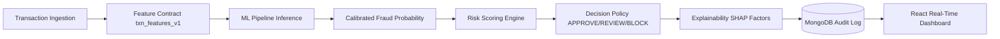

# Z-SENTINEL

**Real-Time AI Fraud Risk & Decision Engine for IBM Z Datathon 2026**  
*Challenge: Real-Time AI for Critical Decisions*

---

## 1. Project Overview

**Z-Sentinel** is a full-stack, real-time AI-powered transaction fraud detection and decision-support system built for the IBM Z Datathon.

### The Problem
Traditional rule-based fraud detection systems in high-volume transaction environments are either too slow or too rigid, leading to high false-positive rates (frustrating legitimate cardholders) and missed fraud patterns. 

### The Z-Sentinel Solution
Z-Sentinel delivers low-latency, interpretable machine learning inference at the transaction evaluation boundary:
- Validates transactions against strict feature contract `txn_features_v1`.
- Executes an offline-trained, versioned ML pipeline (`ZS-PIPE-1.0`) with calibrated probability scoring.
- Maps fraud probability (0–1.0) into a continuous Risk Score (0–100) and discrete Risk Levels (`LOW`, `MEDIUM`, `HIGH`).
- Recommends policy decisions (`APPROVE`, `REVIEW`, `BLOCK`).
- Generates evidence-based local feature explanations (SHAP / linear feature contribution).
- Persists complete audit logs with unique IDs and idempotency in MongoDB.
- Provides a real-time reactive dark navy dashboard with simulation controls and model evaluation transparency.



> **Important Datathon Honesty Boundary:**  
> This application is a working prototype. The default model was trained and evaluated on a reproducible, clearly-labeled synthetic transaction dataset generated by `ml/train.py`. The project documents a proposed integration with IBM Z / Machine Learning for IBM z/OS (MLz), but is not deployed on mainframe hardware.

---

## 2. System Architecture

```
Z-Sentinel/
├── backend/
│   ├── app/
│   │   ├── config.py             # Settings via pydantic-settings & .env
│   │   ├── database.py           # MongoDB connection with mongomock fallback
│   │   ├── explainability.py     # SHAP tree & linear feature contributions
│   │   ├── feature_engineering.py# Shared feature contract txn_features_v1
│   │   ├── genai_summary.py      # Structured evidence investigation summaries
│   │   ├── main.py               # FastAPI application with dual-path endpoints
│   │   ├── ml_model.py           # Model lifecycle & inference
│   │   ├── paypal_service.py     # Optional verified PayPal Sandbox webhook
│   │   ├── prediction_service.py # Scoring, policy application & persistence
│   │   ├── repositories/         # Transaction repository & MongoDB queries
│   │   ├── risk_engine.py        # Configurable risk policy engine
│   │   ├── schemas.py            # Pydantic request & response models
│   │   └── simulator.py          # Synthetic transaction scenario generator
│   ├── tests/                    # 18 automated pytest test cases
│   ├── requirements.txt          # Python dependencies
│   ├── pytest.ini                # Pytest configuration
│   └── .env.example              # Environment variables template
├── ml/
│   ├── artifacts/                # Trained model pipeline, evaluation & metadata
│   ├── data/                     # Synthetic and user-supplied datasets
│   ├── train.py                  # Reproducible training & evaluation pipeline
│   └── evaluate.py               # Offline metrics display utility
├── frontend/
│   ├── src/
│   │   ├── components/           # Header, ModelStatus, RiskChart, Tables, etc.
│   │   ├── api.js                # Centralized Axios API client
│   │   ├── App.jsx               # Dashboard application root with stream simulation
│   │   ├── App.css               # Premium styling & dark navy design system
│   │   └── index.css             # Base styles & tokens
│   └── package.json              # React 19, Vite, Recharts, Axios
└── docs/                         # Architecture, API, and IBM Z integration guides
```

---

## 3. Technology Stack

- **Backend Framework:** FastAPI 0.115+, Uvicorn, Python 3.11–3.13
- **Validation & Settings:** Pydantic 2.10+, Pydantic-Settings 2.7+
- **Machine Learning:** Scikit-Learn 1.5+, NumPy, Pandas, Joblib, SHAP
- **Database:** MongoDB 7 / MongoDB Atlas (with in-memory `mongomock` fallback)
- **Frontend:** React 19, Vite, Recharts, Axios
- **Testing:** Pytest, HTTPX TestClient

---

## 4. Quick Start (Windows & PowerShell)

### Prerequisites
1. **Python 3.11, 3.12, or 3.13** installed.
2. **Node.js 20+** installed.
3. **MongoDB** (local MongoDB instance on port 27017, MongoDB Atlas connection string, or default mock fallback).

---

### Step 1: Set Up Backend

Open PowerShell in the project directory:

```powershell
cd backend
python -m venv venv
.\venv\Scripts\Activate.ps1
python -m pip install --upgrade pip
pip install -r requirements.txt
```

Create `.env` from `.env.example`:
```powershell
copy .env.example .env
```

---

### Step 2: Train the ML Model

Before starting the server, generate the versioned model artifact (`ml/artifacts/zsentinel_pipeline_v1.joblib`):

```powershell
cd ..\ml
..\backend\venv\Scripts\python.exe train.py
..\backend\venv\Scripts\python.exe evaluate.py
```

This trains candidate models (Logistic Regression, Random Forest, optional XGBoost), balances class weights, calibrates probabilities using isotonic regression, tunes optimal decision thresholds on validation data, and generates `evaluation.json` and `metadata.json`.

---

### Step 3: Run Backend Server

In a PowerShell terminal:

```powershell
cd backend
.\venv\Scripts\python.exe -m uvicorn app.main:app --reload --host 127.0.0.1 --port 8000
```

Verify backend health:
- Browser / cURL: `http://127.0.0.1:8000/api/health`
- Interactive API Docs (Swagger UI): `http://127.0.0.1:8000/docs`
- ReDoc: `http://127.0.0.1:8000/redoc`

---

### Step 4: Run Frontend Dashboard

Open a **separate** PowerShell terminal:

```powershell
cd frontend
npm install
npm run dev
```

Open the dashboard in your browser:
**`http://localhost:5173`**

---

## 5. API Endpoints

All endpoints are available directly and prefixed with `/api/`:

| Endpoint | Method | Purpose |
| --- | --- | --- |
| `/health` or `/api/health` | `GET` | Service, model, and MongoDB status |
| `/model/status` or `/api/model/status` | `GET` | Active model version, algorithm, thresholds |
| `/model/metrics` or `/api/model/metrics` | `GET` | Test PR-AUC, ROC-AUC, F1, confusion matrix |
| `/predict` or `/api/predict` | `POST` | Evaluate a transaction and store audit record |
| `/transactions` or `/api/transactions` | `POST` | Ingest and score transaction |
| `/transactions` or `/api/transactions` | `GET` | Retrieve paginated transactions (filter by risk/decision) |
| `/transactions/{id}` or `/api/transactions/{id}` | `GET` | Retrieve specific transaction audit log |
| `/simulate` or `/api/transactions/simulate` | `POST` | Run synthetic scenario evaluation |
| `/stats` or `/api/stats` | `GET` | Total, high-risk, approved, review, blocked stats |
| `/risk` or `/api/risk` | `GET` | Risk distribution counts (LOW, MEDIUM, HIGH) |
| `/paypal/webhook` or `/api/paypal/webhook` | `POST` | Optional verified PayPal Sandbox webhook |

Detailed API specifications are documented in [`docs/api.md`](docs/api.md).

---

## 6. Running Tests

Run the backend test suite:

```powershell
cd backend
.\venv\Scripts\python.exe -m pytest -v
```

All 18 automated tests cover:
- Health check and readiness verification
- Valid and invalid transaction validation (Pydantic schemas)
- Prediction response fields, probability ranges, and risk scoring
- Decision mapping (APPROVE, REVIEW, BLOCK)
- Feature engineering, imputation defaults, and unavailability listing
- Model loading and metadata inspection
- Offline evaluation metrics retrieval
- MongoDB audit storage and aggregation (using in-memory mock)
- Idempotency and duplicate webhook event rejection
- Synthetic transaction simulation

Test frontend production build:
```powershell
cd frontend
npm run build
npm run lint
```

---

## 7. Interactive Features in the Dashboard

1. **KPI Cards:** Live counts of total transactions, high-risk flags, approved, review, blocked, and average inference latency (ms).
2. **AI Model Pipeline Panel:** Displays loaded model version, algorithm, decision thresholds, and expandable evaluation metrics (PR-AUC, ROC-AUC, Precision, Recall, FPR).
3. **Real-Time Visualizations:**
   - **Risk Distribution:** Donut chart of Low, Medium, and High risk proportions.
   - **Decision Distribution:** Bar chart of Approve, Review, and Block volumes.
   - **Volume Timeline:** UTC line chart tracking transactions over time.
4. **Simulator Controls:**
   - Select predefined fraud scenarios: `High Amount (Online)`, `Legitimate Grocery`, `New Device Travel`, `Night Velocity Spike`, `Location Spike`.
   - **Simulate Once:** Immediately scores and logs one synthetic transaction.
   - **Auto-Stream:** Continuous streaming simulation (one transaction every 3.5s) to demonstrate live dashboard reactivity.
5. **Interactive Prediction Form:** Test custom values for amount, currency, merchant category, velocity, device novelty, and channel.
6. **Detailed Explanation Card:** Shows exact local feature contributions, directional impact, and investigation summary.
7. **Audit Log Table:** Paginated table with filtering by Risk Level and Decision. Clicking any row inspects its detailed factors.

---

## 8. IBM Z / MLz Architecture & Integration

In an enterprise banking architecture:
1. Core transaction monitors (**CICS / IMS**) on IBM Z receive authorization requests.
2. The transaction program extracts pre-authorization features matching `txn_features_v1`.
3. The host calls the scoring engine (Machine Learning for IBM z/OS or containerized portable inference).
4. Inference returns probability, score, decision recommendation, and audit factors within single-digit milliseconds.
5. The host posts the financial transaction and stores the audit record.

See [`docs/ibm_z_integration.md`](docs/ibm_z_integration.md) for architectural diagrams and security considerations.

---

## 9. Troubleshooting Guide

| Issue | Cause | Fix |
| --- | --- | --- |
| `ModuleNotFoundError: No module named 'pydantic_settings'` | Running global python without virtual environment | Run with `.\venv\Scripts\python.exe` or run `python -m pip install pydantic-settings`. |
| Port 8000 already in use (`[Errno 10048]`) | A previous Uvicorn or Python process is still bound | Run `Get-NetTCPConnection -LocalPort 8000` and stop the PID via `Stop-Process -Id <PID> -Force`. |
| `ModelNotReady: Model artifact not found` | Model has not been trained yet | Run `python ml/train.py` from the project root or `ml/` directory. |
| MongoDB connection failed | MongoDB service not running | Start local MongoDB, configure Atlas in `backend/.env`, or leave `MONGODB_FALLBACK_MOCK=true` for automatic in-memory fallback. |
| CORS errors in browser console | Origin not listed in backend settings | Ensure `FRONTEND_ORIGINS` in `backend/.env` includes `http://localhost:5173`. |
| PayPal webhook returns 503 | PayPal credentials not configured | PayPal Sandbox is optional; add `PAYPAL_CLIENT_ID`, `SECRET`, and `WEBHOOK_ID` to `.env` only if testing PayPal webhooks. |

---

## 10. License

MIT License. See [LICENSE](LICENSE) for details.
