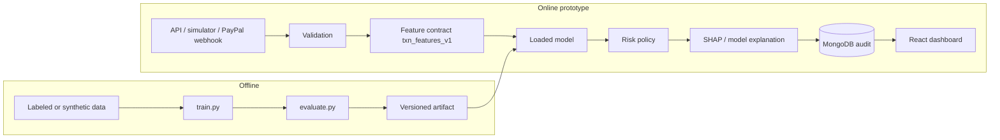

# Z-Sentinel architecture

Z-Sentinel is a portable inference and decision service. The live prototype runs locally with FastAPI, a saved scikit-learn pipeline, MongoDB, and a React dashboard.

## Responsibilities

| Area | Implementation |
| --- | --- |
| Feature contract | `backend/app/feature_engineering.py` and `txn_features_v1` |
| Training | `ml/train.py` — Logistic Regression, Random Forest, optional XGBoost |
| Inference | FastAPI loads `ml/artifacts/zsentinel_pipeline_v1.joblib` once at startup |
| Decision | `backend/app/risk_engine.py` prototype thresholds |
| Explainability | SHAP Tree/Linear explainer with model-specific fallback |
| Persistence | MongoDB `transactions` collection |
| Dashboard | React + Vite consuming `/api/*` |

## Honesty boundary

1. **Implemented and tested locally:** training, API inference, SHAP factors, MongoDB audit, dashboard, pytest suite (Mongo mocked).
2. **Optional demonstration:** PayPal Sandbox webhooks when credentials and HTTPS are configured. Capture-completed events are not pre-capture blocks.
3. **Not deployed:** IBM Z / Machine Learning for IBM z/OS. See `docs/ibm_z_integration.md`.
